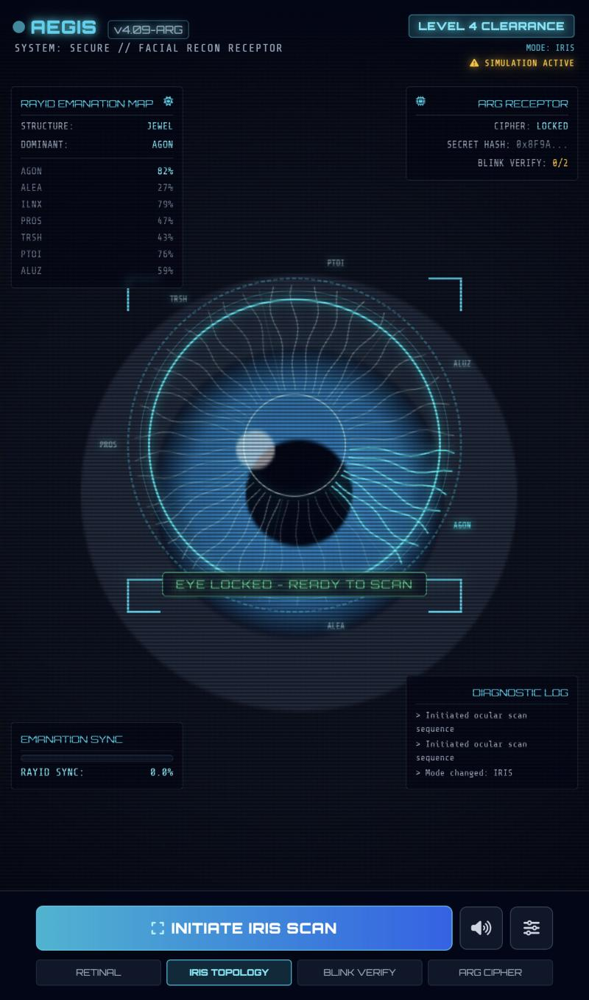
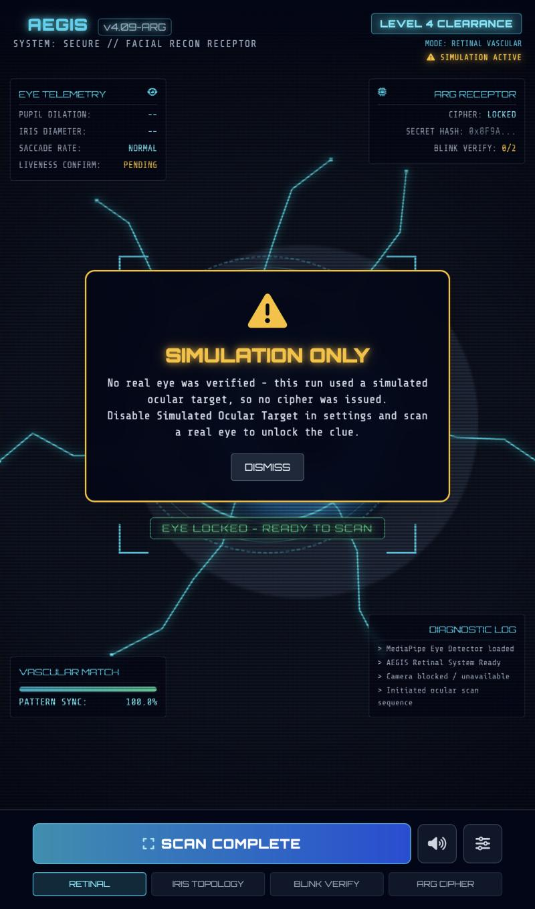
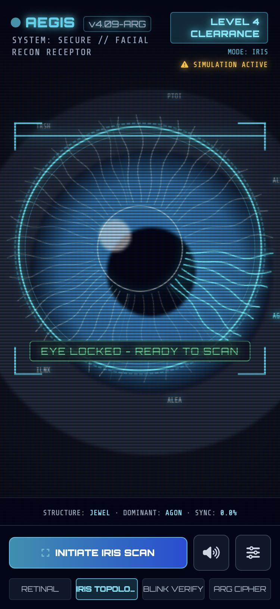

# AEGIS Ocular Retinal Scanner

**A single-file, browser-based "biometric scanner" prop for alternate reality games — built on real-time face tracking, not smoke and mirrors.**

[](https://vincentkovar.github.io/aegis-retinal-scanner/)
[](#tech-stack)
[](#)

<p align="center">
  
</p>

A player opens this on their phone, points the camera at their own eye, and watches a full sci-fi security terminal lock onto their iris in real time — zoom, vascular overlay, a glyph slowly surfacing from the pupil like it's being *called up* from somewhere. It's a prop built to feel real, because the eye tracking underneath it actually is.

---

## What it does

**Real eye tracking, not a canned animation.** MediaPipe FaceMesh runs live against the camera feed, locating the iris and eye-corner landmarks every frame. The HUD doesn't fake a lock — it genuinely doesn't have one until your eye is in frame.

**Four scan modes, one shared rig:**

| Mode | What it reads |
|---|---|
| `RETINAL` | A procedurally generated vascular tree, mapped onto the iris and animated per scan |
| `IRIS TOPOLOGY` | A 7-sector **Rayid-style emanation wheel** (see [Design Notes](#design-notes)) with a Jewel/Stream constitution reading |
| `BLINK VERIFY` | Eye-aspect-ratio blink detection as a liveness check |
| `ARG CIPHER` | Renders a hidden, host-configurable cipher string over the iris once a scan is deep enough |

**It actually zooms in.** The raw camera frame is drawn to an offscreen buffer, then a crop centered on the detected eye is magnified into the visible canvas — an animated digital zoom that locks on as soon as tracking finds you, not a CSS trick on a static image.

**Something surfaces from the pupil.** A glyph (placeholder: a winking infinity symbol) resolves out of the dark the longer a scan runs — blurred and dim at first, sharpening into focus as match progress climbs, then periodically "winking" as one lobe briefly closes like an eyelid. Swap in any image asset; the reveal/wink choreography is decoupled from what's actually drawn.

**The eye has to actually be there.** This is the part that matters for a puzzle gate: a scan can't complete on a dropped camera, a photo held up to the lens, or a settings toggle. See [Integrity model](#integrity-model) below.

---

## Integrity model

Early builds of this prop had a hole: if the camera failed — permissions denied, no HTTPS, no hardware — the app silently fell back to a simulated demo eye, and that fake eye was just as capable of completing a scan as a real one. On a phone without a secure origin, every scan would "succeed" without ever looking at anyone.

That's closed now:

- **Continuous presence, not just a start-gate.** Losing camera lock mid-scan for more than ~600ms aborts the scan outright — it doesn't quietly pause and let you finish later with a different eye, or no eye at all.
- **Simulated mode can't unlock anything.** The demo fallback still runs the full scan animation (useful for testing the UI without a camera), but it resolves to a clearly distinct **"Simulation Only"** result — no cipher, no copy-to-clipboard, nothing a player could carry forward.
- **Always-visible state.** A small amber `SIMULATION ACTIVE` badge is on screen the entire time simulated mode is live, so it's never ambiguous whether the thing on screen is reading a real eye.

<p align="center">
  
</p>

---

## Try it

**[Open the live scanner →](https://vincentkovar.github.io/aegis-retinal-scanner/)**

Point it at your own eye. Camera access needs a secure context (HTTPS, which GitHub Pages provides, or `localhost`) — mobile browsers block camera permissions on plain HTTP, and the app will fall back to the simulated eye if it can't get a real feed.

<p align="center">
  
</p>

---

## Design notes

The iridology layer is a fiction, not a method — iridology has no basis in clinical diagnosis, and nothing here claims otherwise. What's borrowed is purely structural: the **Rayid Method**'s idea of reading iris *fiber structure* (tight, radial "Jewel" patterns vs. flowing "Stream" patterns) as a personality lens, rather than classic iridology's organ-zone chart.

The seven "emanations" read off the iris wheel aren't invented for this scanner — they're this ARG's existing taxonomy (`Agon`, `Alea`, `Ilinx`, `Prosopon`, `Trishna`, `Ptoia`, `Aluzinnu`), drawn from Roger Caillois' categories of play plus a few original additions, reused here so the scanner speaks the same in-fiction language as the rest of the game.

Deliberately *not* documented here: what the cipher actually says, what the clue unlocks, or how the pieces connect to the rest of the game. That's for players to find.

---

## Tech stack

- **Vanilla JS + Canvas 2D** — no framework, no build step, one HTML file
- **[MediaPipe Face Mesh](https://developers.google.com/mediapipe)** (via CDN) for real-time iris/eye-corner landmark tracking
- **Tailwind CSS** (via CDN, JIT-in-browser) for the HUD chrome
- **Web Audio API** for the sci-fi UI sound synthesis — no audio files, every beep/chime/glitch is a synthesized oscillator
- **FontAwesome + Google Fonts** (Orbitron, Share Tech Mono) for the terminal aesthetic

Everything external loads from a CDN, so the only thing you own is `arg_sci_fi_retinal_scanner.html`.

## Running locally

```bash
git clone https://github.com/VincentKovar/aegis-retinal-scanner.git
cd aegis-retinal-scanner
python3 -m http.server 8080
```

Then open `http://localhost:8080`. `localhost` counts as a secure context, so real camera access works without any extra setup. Opening the file directly (`file://`) will generally *not* get camera permissions — serve it.

## Project structure

```
.
├── arg_sci_fi_retinal_scanner.html   # the entire app — HUD, tracking, rendering, audio
├── index.html                        # thin redirect → the file above, for a clean Pages URL
└── docs/screenshots/                 # README images
```

Everything lives in one file on purpose — it's a prop meant to be handed off, forked, and re-skinned for other ARGs without untangling a build pipeline.

---

*Part of an ongoing ARG. The scanner is real; the mystery isn't telling.*
